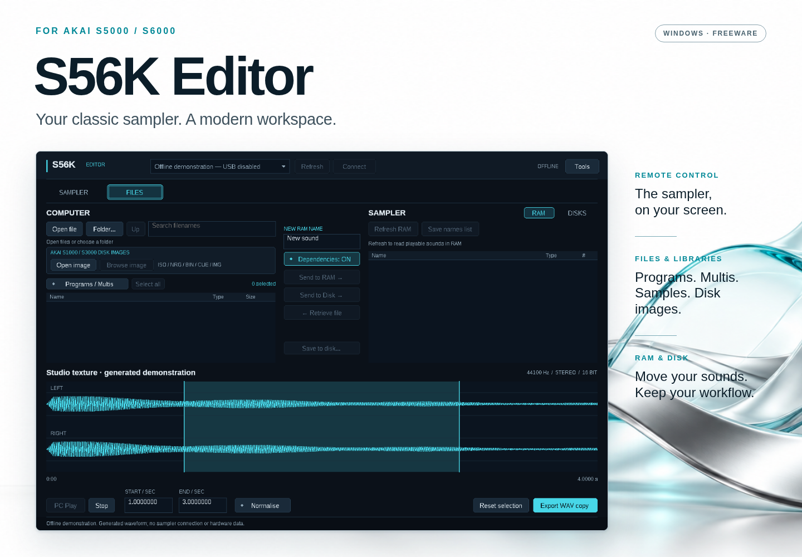
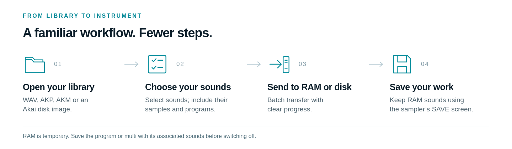

# S56K Editor

**Your classic sampler. A modern workspace.**

A free Windows companion for the **AKAI S5000 and S6000**. Control the sampler from your desktop, move samples and instruments over USB, browse its disks, and bring classic Akai disk-image libraries into your workflow.

**[Download for Windows](https://github.com/Tubbritt/S56K-Editor/releases/download/v0.11.1-preview/S56K-Editor-0.11.1-Preview-win64.zip) · [Get started](docs/USER_GUIDE.md#start-here) · [Illustrated manual](docs/USER_GUIDE.md) · [PDF manual](docs/S56K-Editor-0.11.1-User-Guide.pdf) · [USB setup](docs/USB_SETUP.md) · [Release history](CHANGELOG.md)**

> **0.11.1 Preview · Windows x64 · Freeware**  
> Requires an **IB-S56USB card** in the sampler and Microsoft's **WinUSB** driver. No ak.Sys installation or sampler firmware update is required to use the Editor.

### The instrument, within reach

Use the familiar front-panel controls from your computer. Click recognised options on the LCD, use the keyboard and data controls, and enter names when a supported naming field is open. The display follows the sampler automatically while the Sampler page is active.

The screen above is the real application using a native LCD frame in offline preview. The Editor controls the connected instrument; it does not emulate a sampler.

**[Explore the sampler workspace →](docs/USER_GUIDE.md#your-sampler-on-screen)**

### A better home for your library

Keep computer files and sampler destinations in view. Select **WAV samples, AKP programs or AKM multis**, include their dependencies, and send a batch to **RAM** or a writable sampler disk. Retrieve supported files, browse sampler folders, and inspect WAV audio on a larger waveform display.

Transfer progress shows the current file and overall job. Optional read-back verification lets you choose the extra check when you need it.

**[Move samples, programs and multis →](docs/USER_GUIDE.md#one-files-page-two-destinations)**

### Open the classics

Browse supported **S1000 / S3000 disk-image libraries** without burning a CD. Open **ISO, NRG, BIN, CUE or IMG**, choose instruments, and prepare and send them in one workflow. The picker remembers your library folder between sessions.

These extensions identify containers; the contents must use a supported layout. Some legacy parameters, record types or damaged images cannot be converted faithfully and remain blocked with an explanation. Read the [format guide](docs/FORMATS.md) before importing a large library.

**[Browse and transfer a disk image →](docs/USER_GUIDE.md#open-your-akai-disk-image-library)**

### Built for the way you work

| Feature | What you can do |
| --- | --- |
| **Live sampler control** | Use front-panel keys, recognised LCD controls, text entry and data adjustments. |
| **Samples, programs and multis** | Transfer WAV, AKP and AKM with associated sounds. |
| **RAM and disk destinations** | Send playable sounds to RAM or supported files to writable sampler storage. |
| **Classic image libraries** | Browse supported Akai images and batch-send their instruments. |
| **Waveform workspace** | Preview supported WAV audio on the PC, select a range and export a WAV copy. |
| **Clear transfer progress** | See each file and the overall batch; request a stop after the current file. |
| **Optional verification** | Read uploaded contents back when you want an additional check. |
| **USB setup assistance** | Open **Tools → USB driver setup** to inspect the Akai device and reach Windows' driver wizard. |
| **Local troubleshooting** | Save a screen image or session log from Tools. No automatic report uploads. |

**RAM is temporary.** Sending a program to RAM does not save it to disk. Save sounds you want to keep, including their samples, before switching the sampler off.

### Download and start

1. **[Download the Windows ZIP](https://github.com/Tubbritt/S56K-Editor/releases/download/v0.11.1-preview/S56K-Editor-0.11.1-Preview-win64.zip)** and extract it into a new folder.
2. Open **START_HERE.html** for the illustrated offline guide.
3. Run **S56K-Editor.exe**, connect the sampler by USB and choose **Connect**. If needed, follow **Tools → USB driver setup**.

Windows may identify this unsigned app as an unknown publisher. Check the download location and [published checksum](https://github.com/Tubbritt/S56K-Editor/releases/download/v0.11.1-preview/S56K-Editor-0.11.1-Preview-win64.zip.sha256); do not disable Windows security or driver-signature enforcement.

**[Release notes and checksums](releases/README.md) · [Troubleshooting](docs/TROUBLESHOOTING.md) · [Report a problem](https://github.com/Tubbritt/S56K-Editor/issues/new/choose)**

### Three separate tools, one sampler

| Project | Purpose |
| --- | --- |
| **S56K Editor** | Desktop control, file management and library transfers. This repository. |
| **[S56K Expanded Edition](https://github.com/Tubbritt/S56K-Expanded-Edition)** | Optional sampler firmware with Auto Sample and Auto Loop features. |
| **[S56K Firmware Updater](https://github.com/Tubbritt/S56K-Expanded-Edition/releases)** | A separate app for installing supported firmware images. |

The Editor does **not** install firmware. Neither a firmware BIN nor the updater is included in its download.

---

Independent community software; not an official AKAI product or an AKAI-endorsed release. AKAI and other trademarks belong to their respective owners.

**Free for personal use, professional studios and commercial music production.** Read the [Freeware Licence](LICENSE.md), [disclaimer](DISCLAIMER.md) and [third-party notices](THIRD-PARTY-NOTICES.md).

**Release files only.** This repository contains compiled downloads, documentation and artwork. The Editor's application source code is private and will not be published here.
