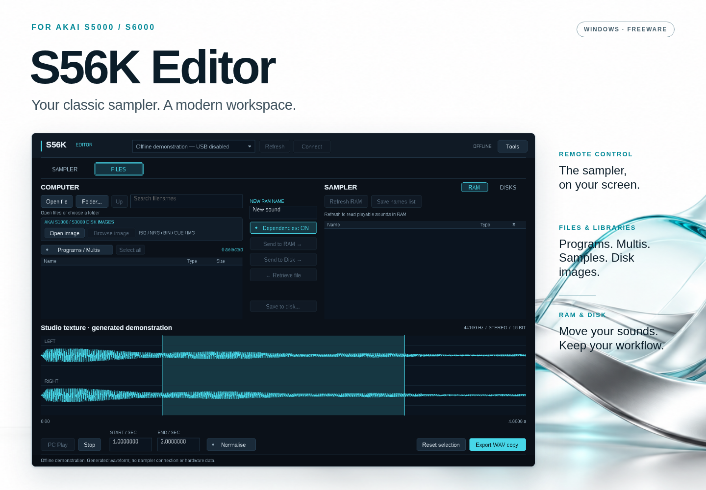
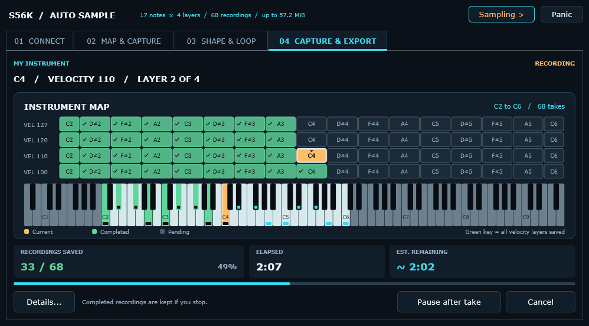
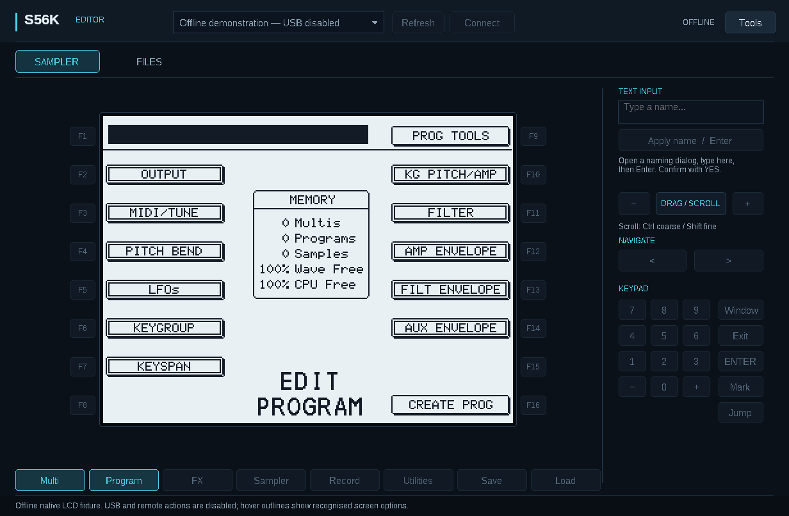
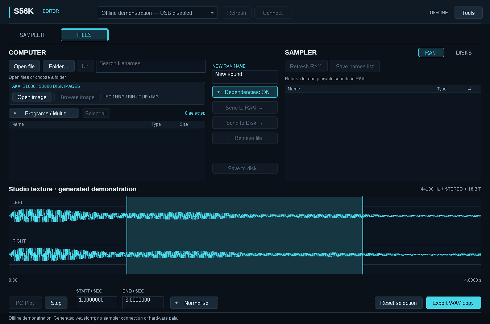
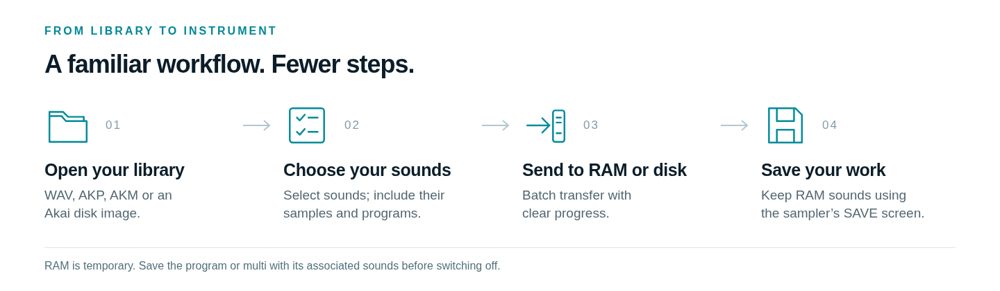
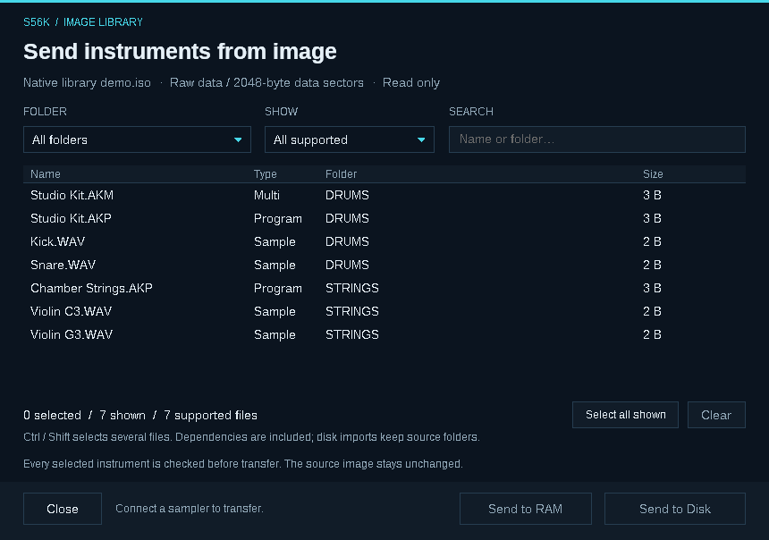

# S56K Editor

**Your classic sampler. A modern workspace.**

A free Windows companion for the **AKAI S5000 and S6000**. Play and control your sampler from the desktop, move instruments over USB, open classic Akai disk images, and **auto sample hardware synths or VST3 instruments into native AKP programs and WAV samples**.

**[Download for Windows](https://github.com/Tubbritt/S56K-Editor/releases/download/v0.12.8-preview/S56K-Editor-0.12.8-AutoSample-Preview-win64.zip) · [Get started](docs/USER_GUIDE.md#start-here) · [Illustrated manual](docs/USER_GUIDE.md) · [PDF manual](docs/S56K-Editor-0.12.8-User-Guide.pdf) · [USB setup](docs/USB_SETUP.md) · [Release history](CHANGELOG.md)**

> **0.12.8 Auto Sample Preview · Windows 11 x64 · Freeware** 
> Sampler control and transfers use its **IB-S56USB card** with Microsoft **WinUSB**. PC Auto Sample and playing its selected synth or VST3 instrument work without a sampler connected. No ak.Sys installation or sampler firmware update is required.

**New in this release:** MIDI Keyboard, integrated hardware/VST3 Auto Sample, ASIO, automatic looping and clean AKP/WAV export. [See all changes since 0.11.1 →](CHANGELOG.md#0128-auto-sample-preview--2-november-2026)

### Your next instrument starts here

Capture a hardware synth through your computer's audio interface, or load a **64-bit VST3 instrument** and render its sound on the PC. Choose notes and up to four velocity layers, shape the recordings, find and crossfade sustain loops, then export a playable **S5000/S6000 program and its WAVs**.

The instrument map shows the current take in amber, completed takes in green and the notes still to record. Elapsed time and an adapting estimate keep longer sessions clear. Review and audition the results, then **Open in Files** to send the instrument to sampler RAM or disk.

| Auto Sample page | What you set |
| --- | --- |
| **01 Connect** | Hardware or VST3, MIDI routing, audio interface, ASIO or Windows audio, and a test note. |
| **02 Map & Capture** | Note range, step, velocity layers, timing and signal detection. |
| **03 Shape & Loop** | Trim, normalization, loop-search region, crossfade and crop settings. |
| **04 Capture & Export** | Patch name and export folder, live capture progress, take review, resume and reprocessing. |

Your chosen export folder receives the **AKP and its WAV files directly**. Working recordings stay separately managed, with an option to retain them for later reprocessing. Hardware recording runs in real time; accelerated VST3 rendering can run faster when the instrument supports it.

**[Illustrated Auto Sample guide →](docs/AUTO_SAMPLER_GUIDE.md)**

### Play it from your keyboard

Connect a MIDI keyboard to the PC and choose its destination in **MIDI KEYBOARD**: your **Akai over USB**, or Auto Sample's selected **external synth or loaded VST3**. The computer-side route works without an Akai connected. Keyboard selection is remembered, LCD updates continue while playing the sampler, and routine parameter changes preserve held notes.

For VST3 playing and hardware recording, select your audio interface under **Auto Sample → Connect → Audio settings**. Manufacturer **64-bit ASIO drivers** and Windows audio are supported. The sampler's USB connection carries control and file transfers; audio comes from its physical outputs.

**[Set up MIDI Keyboard →](docs/AUTO_SAMPLER_GUIDE.md#play-from-a-midi-keyboard)**

### The instrument, within reach

Use the familiar front-panel controls from your computer. Click recognised options on the LCD, use the keyboard and data controls, and enter names when a supported naming field is open. The display follows the sampler automatically while the Sampler page is active.

The screen above is the real application using a native LCD frame in offline preview. The Editor controls the connected instrument; it does not emulate a sampler.

**[Explore the sampler workspace →](docs/USER_GUIDE.md#your-sampler-on-screen)**

### A better home for your library

Keep computer files and sampler destinations in view. Select **WAV samples, AKP programs or AKM multis**, include their dependencies, and send a batch to **RAM** or a writable sampler disk. Retrieve supported files, browse sampler folders, and inspect WAV audio on a larger waveform display.

Transfer progress shows the current file and overall job. Optional read-back verification lets you choose the extra check when you need it.

**[Move samples, programs and multis →](docs/USER_GUIDE.md#one-files-page-two-destinations)**

### Open the classics

Browse supported **S1000 / S3000 disk-image libraries** without burning a CD. Open **ISO, NRG, BIN, CUE or IMG**, choose instruments, and prepare and send them in one workflow. The picker remembers your library folder between sessions.

These extensions identify containers; the contents must use a supported layout. Some legacy parameters, record types or damaged images cannot be converted faithfully and remain blocked with an explanation. Read the [format guide](docs/FORMATS.md) before importing a large library.

**[Browse and transfer a disk image →](docs/USER_GUIDE.md#open-your-akai-disk-image-library)**

### Built for the way you work

| Feature | What you can do |
| --- | --- |
| **Live sampler control** | Use front-panel keys, recognised LCD controls, text entry and data adjustments. |
| **MIDI Keyboard** | Play the Akai over USB, an external synth or Auto Sample's loaded VST3. |
| **PC Auto Sample** | Capture hardware or render a VST3 instrument across a note/velocity map. |
| **Loop and shape** | Trim, normalize, search for sustain loops, crossfade and crop captured recordings. |
| **Native instrument export** | Create an AKP and its WAVs, then send them to sampler RAM or disk. |
| **Samples, programs and multis** | Transfer WAV, AKP and AKM with associated sounds. |
| **RAM and disk destinations** | Send playable sounds to RAM or supported files to writable sampler storage. |
| **Classic image libraries** | Browse supported Akai images and batch-send their instruments. |
| **Waveform workspace** | Audition and edit supported WAVs; edited native Akai WAVs retain supported tuning, playback and sample bounds. |
| **Clear transfer progress** | See each file and the overall batch; request a stop after the current file. |
| **Optional verification** | Read uploaded contents back when you want an additional check. |
| **USB setup assistance** | Open **Tools → USB driver setup** to inspect the Akai device and reach Windows' driver wizard. |
| **Local troubleshooting** | Save a screen image or session log from Tools. No automatic report uploads. |

**RAM is temporary.** Sending a program to RAM does not save it to disk. Save sounds you want to keep, including their samples, before switching the sampler off.

### Download and start

1. **[Download the Windows ZIP](https://github.com/Tubbritt/S56K-Editor/releases/download/v0.12.8-preview/S56K-Editor-0.12.8-AutoSample-Preview-win64.zip)** and extract it into a new folder.
2. Open **START_HERE.html** for the illustrated offline guide.
3. Run **S56K-Editor.exe** and keep the complete extracted folder together, including **internal**.
4. For sampler control/transfers, connect by USB and choose **Connect**; use **Tools → USB driver setup** if needed. For PC Auto Sample, choose **AUTO SAMPLE** and configure your instrument and audio interface.

Windows may identify this unsigned app as an unknown publisher. Check the download location and [published checksum](https://github.com/Tubbritt/S56K-Editor/releases/download/v0.12.8-preview/S56K-Editor-0.12.8-AutoSample-Preview-win64.zip.sha256); do not disable Windows security or driver-signature enforcement.

**[Release notes and checksums](releases/README.md) · [Troubleshooting](docs/TROUBLESHOOTING.md) · [Report a problem](https://github.com/Tubbritt/S56K-Editor/issues/new/choose)**

### Three separate tools, one sampler

| Project | Purpose |
| --- | --- |
| **S56K Editor** | Desktop control, MIDI Keyboard, PC Auto Sample, file management and library transfers. This repository. |
| **[S56K Expanded Edition](https://github.com/Tubbritt/S56K-Expanded-Edition)** | Optional sampler firmware with Auto Sample and Auto Loop features. |
| **[S56K Firmware Updater](https://github.com/Tubbritt/S56K-Expanded-Edition/releases)** | A separate app for installing supported firmware images. |

The Editor does **not** install firmware. Neither a firmware BIN nor the updater is included in its download.

---

Independent community software; not an official AKAI product or an AKAI-endorsed release. AKAI and other trademarks belong to their respective owners.

**Free for personal use, professional studios and commercial music production.** Read the [Freeware Licence](LICENSE.md), [disclaimer](DISCLAIMER.md) and [third-party notices](THIRD-PARTY-NOTICES.md).

**Release files only.** This repository contains compiled downloads, documentation and artwork. The Editor's application source code is private and will not be published here.
