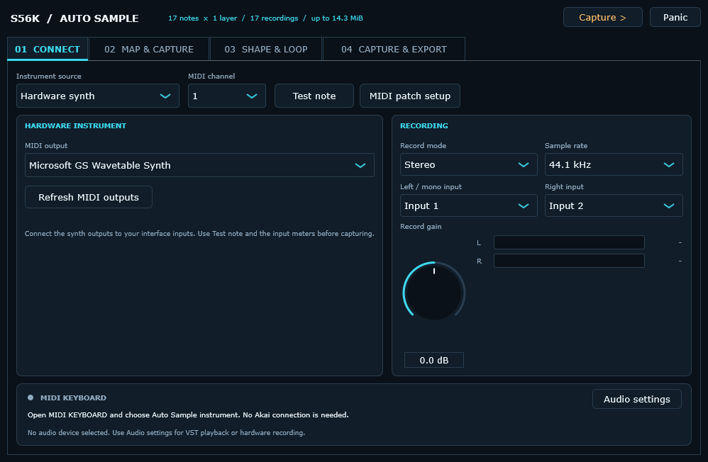
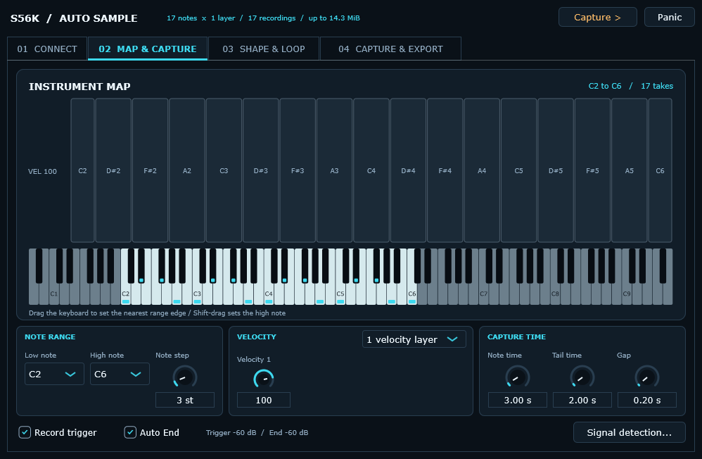
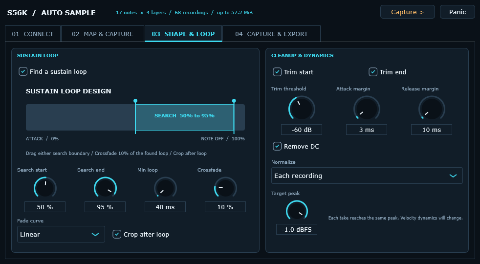
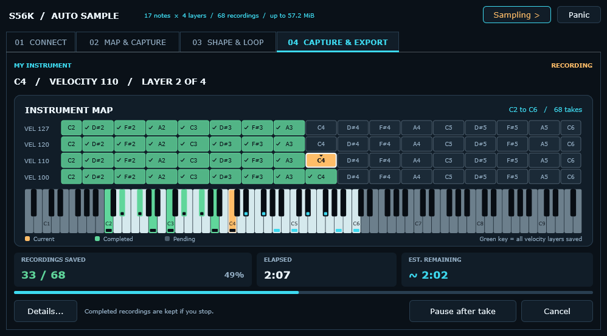
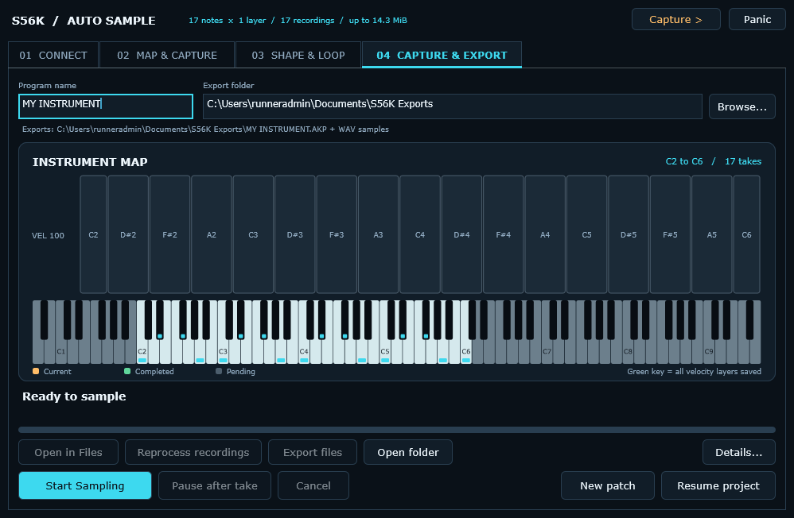

# PC Auto Sample & MIDI Keyboard

[Home](../README.md) · [User guide](USER_GUIDE.md) · [Formats](FORMATS.md) · [Troubleshooting](TROUBLESHOOTING.md)

**0.12.8 Auto Sample Preview · Windows 11 x64**

Capture a hardware synth or a VST3 instrument on your computer, then export a
playable S5000/S6000 program. Start with a few notes and check the result on
your sampler before recording a large instrument.

Auto Sample records a hardware or VST3 instrument at selected notes and
velocities, processes the recordings and creates a program for the AKAI S5000
and S6000. Choose an **Export folder** for the **AKP program and its WAV samples**.
Those native files appear directly in that folder, ready to copy or transfer;
Auto Sample adds no project settings, raw recordings or nested Export folder.
Working recordings are stored separately on the computer. The sampler can be
connected later for transfer.

**AUTO SAMPLE** is a workspace inside the Editor, alongside **SAMPLER** and
**FILES**. Switching workspaces keeps the project and recordings in place.
Start `S56K-Editor.exe`; there is no second application to launch. Extract the
complete ZIP and keep its supporting files together, including the **internal**
folder. Only `S56K-Editor.exe` needs to be launched.

The four main pages use compact controls without a scrolling form. Turn a knob
or enter an exact value in its field. Audio configuration, MIDI patch setup,
signal detection and the capture log open in separate dialogs. The recording
controls appear only on **04 CAPTURE & EXPORT**.

## What connects where

| Task | Connection |
| --- | --- |
| Play the sampler from a keyboard connected to the PC | Keyboard MIDI input → Editor → sampler USB. Hear sound from the sampler's audio outputs. |
| Play an external synth without the sampler | Keyboard MIDI input → Editor → Auto Sample's selected computer MIDI output → synth. Hear sound from the synth or your interface's direct monitor. |
| Play a loaded VST3 without the sampler | Keyboard MIDI input → Editor → Auto Sample's loaded instrument → selected computer audio output. |
| Sample a hardware synth | PC MIDI output → synth MIDI input; synth audio outputs → computer audio-interface inputs. |
| Sample a VST3 instrument | Instrument runs on the PC inside Auto Sample. Rendering does not pass through the sampler or its audio outputs. |
| Test a completed AKP | Editor Files → transfer AKP plus its WAV dependencies to sampler RAM or disk. |

The sampler's USB connection does not provide audio capture. Connecting a synth
by MIDI alone cannot record its sound.

## Play from a MIDI keyboard

**MIDI KEYBOARD** works whether or not an Akai sampler is connected. Select the
keyboard's Windows MIDI input, choose its destination and click **Connect**:

| Destination | Setup and sound output |
| --- | --- |
| **Akai sampler - USB** | Connect the S5000/S6000, select logical input A or B and the intended MIDI channel. Sound comes from the sampler's audio outputs. |
| **Auto Sample instrument - external synth / VST3** | On **AUTO SAMPLE → CONNECT**, choose Hardware and its MIDI output, or choose VST3 and load an instrument. This route does not require an Akai connection. |

For a hardware synth, connect a computer MIDI output to the synth's MIDI input.
Select the receiving channel in **MIDI KEYBOARD**; this is the channel used for
live playing. Auto Sample's own MIDI channel separately controls its test notes
and automatic capture. Hear the synth through its outputs or your interface's
direct-monitor facility. The Editor does not enable audio input monitoring.

For a VST3 instrument, choose the interface and output in **CONNECT → Audio settings**,
then open **MIDI KEYBOARD**, choose **Auto Sample instrument** and click **Connect**.
The loaded instrument plays live through that output. It does not require a
capture project, a Test Note run or an Akai sampler to make sound.

The first **Connect** starts the instrument helper when needed and waits for
the route to become ready. The status shows **Connecting...** during startup.
Use **Disconnect** to stop keyboard input.

Notes, velocity, pitch bend and supported expressive controls follow the chosen
route. Use **Panic** if a note remains sounding. Closing the routing window keeps
input enabled; **Disconnect** disables it. Reopening **MIDI KEYBOARD** shows the
selected input and routing settings. If a previously selected keyboard is
unavailable, choose a connected input explicitly. Changing destinations releases
held notes on the old destination before enabling the new one.

Manual keyboard playing pauses while Auto Sample records, runs a Test Note or
changes its instrument/audio configuration. Notes received during that pause
are discarded so they cannot enter an automatic recording or sound later as a
burst. Play fresh notes when the instrument is ready again. A keyboard routed
to Auto Sample remains independent of the Akai USB connection.

### Playing the Akai while editing

Automatic LCD updates continue while keyboard input is enabled. Keyboard events
have priority: screen requests can briefly wait for a gap in MIDI activity.
Reading the display does not release held notes. Very dense controller traffic
can reduce the display update rate; enabling input alone does not freeze it.

Remote buttons, the DATA wheel and text entry no longer send an automatic
all-notes-off command. You can adjust parameters while playing. The sampler
still processes USB requests in sequence, so very busy control or MIDI input can
affect responsiveness. A parameter change may itself alter the sound.

File transfers and other longer USB tasks release held notes and pause the
**Akai sampler** keyboard route for the complete operation, including gaps
between batch files. Delayed notes are discarded; play a new note after the task
to continue. Auto Sample's computer-side instrument route is separate. The
Editor does not create a Windows virtual MIDI port for other programs.

## Start with a small instrument

1. Select the **AUTO SAMPLE** workspace in the Editor.
2. On **01 CONNECT**, choose **Hardware** or **VST3** and test one note.
3. On **02 MAP & CAPTURE**, choose a small range, one velocity layer and short
   durations. Use the piano keyboard or the Low note / High note fields.
4. On **03 SHAPE & LOOP**, initially leave looping and normalization off. Enable
   trimming if the source has latency or a long silent release.
5. On **04 CAPTURE & EXPORT**, choose an **Export folder**, enter a program
   name, then start. The completed AKP and WAVs go directly into that folder.
6. Review the waveform and any warnings. Transfer the exported AKP with its WAV
   dependencies to the sampler and play it before sampling a larger range.

For a first test, a few adjacent notes at velocity 100 give a useful check of
tuning, level, note length and stereo routing without creating a large library.

## 01 CONNECT

Choose **Hardware** or **VST3** as the source. The page groups instrument and
recording controls, showing the settings relevant to that source. Test-note
controls and a level meter let you check the sound. The connection strip shows
the current MIDI-keyboard route and audio device.

Click **Test note** to play the test; the same button becomes **Stop note** so
you can end it immediately. It returns to **Test note** when the test finishes.

For **Hardware**, open **Audio settings**, select the audio interface and enable the
input channel or pair carrying the synth. Choose the MIDI output connected to
the synth and the channel the synth receives. **MIDI patch setup** holds optional
Bank MSB/LSB, Program Change and controller messages for selecting the patch and
its initial controls. Use
the test note and level meter to set a useful recording level without clipping.
Stereo needs two source audio outputs and two selected interface inputs.

### Choose the audio driver

The **Audio settings** dialog supports **ASIO** as well as Windows audio.
Install your interface manufacturer's **64-bit Windows ASIO driver** first,
then select **ASIO** as the audio device type and select that interface. Enable
the input channels needed for hardware capture and the outputs used for VST3
playing and take review. ASIO commonly uses one interface for both input and
output; choose the channels on that device.

Start with a buffer of **256 or 512 samples** and a supported sample rate.
Use the driver's control panel if it manages buffer size itself. A smaller
buffer reduces playing latency but gives the computer less time to process
complex instruments. If playback crackles or drops out, increase the buffer,
check the instrument's CPU/disk demands and close other applications using the
interface. ASIO support does not guarantee dropout-free operation on every
computer, driver or plugin. No interface driver is bundled with the Editor.

VST3 **Test note** follows the selected interface rate, including 96 kHz.
Auto Sample exports remain at **44.1 or 48 kHz**; auditioning at a different
rate does not change the exported format.

Windows audio remains available when an ASIO driver is not installed. The
selected driver affects live VST3 playback, take review and hardware recording.
Accelerated VST3 rendering runs independently of physical audio timing; changing
to ASIO does not itself make offline rendering faster.

**Record gain** adjusts the incoming signal digitally from −24 to +24 dB. Set the
interface's physical input/preamp level first: reducing software gain cannot
repair clipping that has already happened at the input converter.

For **VST3**, choose a 64-bit instrument and open its editor to select a sound.
Set the sound before starting capture; its state is stored with the working project. **Accelerated rendering** asks
the instrument to render without waiting for real time. Disable it for a plugin
that needs paced processing. A five-second hardware note always needs physical
time to play; offline plugin rendering may be faster, depending on the plugin
and the computer.

A plugin can have its own latency, disk loading, random variation, copy
protection or external dependencies. Auto Sample does not guarantee identical
results across every instrument. An internal helper isolates audio and plugin
processing from the Editor's USB connection while the workspace remains inside
the same Editor window. A plugin failure can still interrupt the current take;
completed recordings remain in the local working session for Resume.

## 02 MAP & CAPTURE

The **INSTRUMENT MAP** displays the planned notes across velocity rows. Its
piano keyboard highlights the selected range and marks the notes that will be
recorded. Drag on the keyboard to move the nearest range edge; **Shift-drag**
sets the high note. The Low note and High note fields update with the graphic,
and remain available for precise choices. This keyboard edits the capture
range; it does not audition notes.

During a run, the current note and velocity are highlighted in amber. Saved
takes turn green and pending takes remain subdued. Each velocity layer has its
own row; a keyboard note becomes green once all its planned layers are saved.

**Low note**, **High note** and **Note step** define the pitch grid. Note names
use **C4 = MIDI note 60**. Some instruments label the same MIDI note C3; match
the pitch rather than the octave text if your synth uses another convention.
Samples fill the selected keyboard range using boundaries halfway between
recorded notes. Native program keygroups are limited to **A0 (MIDI 21) through
G9 (MIDI 127)** by the sampler's program loader.

Choose **one to four velocity layers** with increasing MIDI velocity values.
Each note is recorded at each selected velocity. The resulting AKP uses up to
four velocity zones per keygroup and up to 99 keygroups. A finer pitch grid or
more layers increases both recording time and sample memory. Only the active
velocity-layer controls are shown.

The enlarged map fills the main area. Pitch, velocity and timing knobs sit
below it; there is no separate capture timeline to drag. Use **Note time**,
**Tail time** and **Gap** to set the individual durations directly. These are
maximum times, so Auto End may finish a recording before those limits.

Use **Signal detection** for trigger/end thresholds, timeouts and the early-end
rule. These detailed controls have their own dialog; the note range and timing
stay visible on the main page.

| Control | Meaning |
| --- | --- |
| Note time | How long the MIDI note is held, measured from Note On. |
| Tail time | Maximum audio recorded after Note Off, for the release and effects. |
| Gap | Extra settling time between recordings. |
| Trigger level | Level used to identify the beginning of audible signal. |
| Signal timeout | Maximum wait for a usable signal before reporting a failed capture. |
| Auto End | End a recording after audio remains below the end level for the selected silence hold. |
| End level | Level considered silent for automatic ending. |
| Silence hold | How long the level must stay below the end level; a short dip should not end a useful sound. |
| Minimum take | Minimum time after detected onset before Auto End can finish a recording. |
| Also finish decaying notes before Note Time | Allow a naturally decaying sound to finish before the full note duration. |

Trigger waiting does not postpone Note Off. Set note time long enough for a slow
attack to develop. A threshold too high can miss quiet layers; one below a noisy
hardware input's noise floor may never see silence. Begin with a short test,
watch the meter and adjust both trigger and end settings for the instrument.

With Auto End enabled, tail time is a maximum. A ten-second tail can finish
earlier once the silence rule is satisfied. A sustained sound can use its full
note time and still have its release recorded after Note Off.

## 03 SHAPE & LOOP

**SUSTAIN LOOP DESIGN** shows the search window within the held note: 0% is
the start and 100% is Note Off. Enable **Auto Loop**, then drag either search
boundary or use **Search start** and **Search end** below. This is a
setup diagram, not a waveform. The recorded waveform is shown on **CAPTURE &
EXPORT** after real audio is available. Changing the setup diagram does not
alter an existing recording until you reprocess it.

**Trim start/end** removes audio outside the chosen signal threshold while
retaining the selected start and end margins. A few milliseconds before the
detected attack can protect soft transients. **Remove DC** recentres a waveform
with a constant offset.

Leave **normalization off** to keep the recorded levels unchanged. **Whole
project** normalization applies one gain to every capture and preserves their
relative dynamics. **Each recording** normalization makes every recording reach
the target peak and therefore changes the relative levels of notes and velocity
layers. Normalization cannot repair
clipping that already occurred at the synth or audio interface.

Loop search runs inside the held-note portion. The **start/end percentages**
identify the region in which to find a sustained loop; they are not percentages
of the release tail. Start with a stable sound and a window such as 50–95%.
Crossfade blends the loop boundary; its percentage is based on the resulting
loop length. Linear and equal-power curves suit different material, and a long
crossfade can change the sound.

Loop search also checks fallback candidates for sparse periodic waveforms
whose useful boundaries can fall between its initial search positions. Always
listen to the result before exporting a full instrument.

**Crop after loop** removes release material after the selected loop. A small
guard area is still written for the sampler's interpolation requirements. This
is not a second audible release. Stereo channels share loop points and remain
aligned. Always audition the result: automatic loop matching cannot guarantee a
natural loop for evolving, random or strongly modulated sounds.

## 04 CAPTURE & EXPORT

This is the recording page. Choose an **Export folder**, enter the program name
and start sampling here. During the run, a large keyboard and velocity map
replaces waveform review:

- **Amber / outlined:** the take currently being recorded or processed.
- **Green:** a completed, saved take.
- **Muted:** a take still waiting to be recorded.

The display identifies the current phase, note and velocity layer, with saved
recording totals and percentage. **Elapsed** shows the duration of this run.
**Estimated remaining** adapts to measured capture speed, including accelerated
VST3 rendering and early endings. It shows **Estimating** until a take has
provided a useful measurement. This is an estimate, so changing note lengths or
processing costs can make it move up or down.

A resumed run counts previously saved takes correctly and times the new attempt;
it does not count time spent paused or with the application closed. Once all
recordings are saved, the display shows export/finalization separately instead
of promising an exact finish time. The map stays visible through that stage.
Waveform review returns after the run stops or finishes, so you can inspect and
listen to the actual files. **Details…** opens the capture notices and log.

### Export the native files

The chosen folder receives `<program>.AKP` and its referenced `.WAV` samples
directly. **Open folder** opens this destination; **Open in Files** opens the
export for transfer in the Editor. The page shows the destination AKP path.

If matching filenames already contain different data, capture still finishes
and the Editor asks **Replace existing export files?**. Choose **Replace existing
files** to approve replacing those AKP/WAV files, or **Keep existing**, choose
another Export folder and click **Export files**. This retries publication from
the completed recordings without recording the instrument again. Identical
files are accepted, and unrelated files in the destination are preserved.

Cancellation or a failed publication rolls back newly written or replaced
files. The completed recordings remain available for another export attempt.
To retain two versions of the same patch, choose separate export folders.

### Record another patch

Every new capture gets a separate local working session. The Export folder
can stay the same while you record differently named patches.

- **Start Sampling** records the current plan into a new working session. Its label stays the same after a completed run and after reopening the Editor. Settings and the previous export are remembered across launches; a previous export is identified on page 4. Use **New Patch** for a fresh name and review.
  Existing exports remain until you explicitly approve replacing them.
- **New Patch** clears the program name and current review, keeping the loaded
  instrument, audio/MIDI devices, mapping and processing settings. Select the
  next sound, enter its name and start another run without closing the Editor.
  The currently loaded VST3 sound is retained; New Patch does not reload an old
  preset.
- **Resume project** opens retained working recordings and completes missing
  notes/layers using its saved configuration. Use this to continue an incomplete
  run, rather than starting another project.
- **Reprocess recordings** processes the current project's retained recordings
  into a new revision. It does not record the instrument again.

### Keep recordings for later reprocessing

On Windows, local working sessions live under
`%LOCALAPPDATA%\S56K\Editor\AutoSampleWork`. They hold the original floating-point
recordings, processed masters, saved settings, plugin state when applicable and
recovery information. **Resume project** starts its folder chooser there.

By default, completed working recordings are eligible for cleanup when the
Editor closes normally. Cleanup happens only after the export files and the
complete working inventory have been verified. It removes the managed working
data; the AKP and WAVs in your Export folder stay in place. A missing or changed
export or an unverified working file prevents that cleanup.

Before closing, enable **Details… → Keep working recordings after closing** if
you want to reprocess these recordings in a future session. With that option
off, perform any desired reprocessing before closing. Incomplete, cancelled
and failed sessions are retained for **Resume**.

To adjust trimming, looping or normalization after recording, change the
processing controls and use **Reprocess recordings**. The application uses the
retained originals and writes a new working revision. Choose another Export
folder to keep the earlier export for comparison, or approve replacement when
prompted. Reprocessing keeps the original note grid, velocity layers, sample
rate and channel count; changing
those requires a new recording project.

The saved-recording selector lets you compare **Original recording**,
**Processed master** and **Export WAV**. Choose a take to inspect its waveform
and loop markers, then use **Listen** and **Stop** to audition through the
computer's selected audio output. **Audition loop** appears and is enabled only
when the selected audio has valid loop markers. It plays the attack and then
repeats the saved sustain loop; switch it off for a single pass. The toggle takes
effect during playback and only changes the preview. To create or change a
loop, adjust **SHAPE & LOOP** and use **Reprocess recordings**. The sampler's
keygroup envelope still needs a playback check on the instrument. **Refresh**
rereads the current project's
saved recordings.

Keep an exported AKP together with its referenced WAVs when moving or backing
it up. Do not edit working files during a run. Resume verifies settings
and existing recordings; a changed or missing capture is reported.

**Pause after take** finishes the current recording before stopping. **Cancel**
discards the unfinished current take. Both keep recordings already completed.

The AKP is exported after the complete planned grid is present. If capture stops
partway through, resume the project to complete the missing notes/layers. A
silent or failed recording does not create a placeholder sample in the program.

## Transfer to the sampler

After sampling and export verification finish, use **Open in Files** to switch to **FILES**, or select **FILES**
and open your chosen **Export folder**.
Select the AKP and include its dependencies, then use **Send to RAM** or
**Send to Disk** as appropriate. The WAVs contain the actual sound; the AKP
contains the keygroups, velocity zones and references to those samples.

**Send to RAM** makes the instrument available for testing. Use the sampler's
normal Save workflow if you want to retain it on its disk. **Send to Disk**
writes files to the chosen sampler disk location; load the program from there
when you want to play it. The sampler's available memory still limits how much
audio can be loaded at once, even when the project is large on the computer.

For the first test of this feature, leave read-back verification enabled and
check root pitches, transitions between sampled notes, every velocity layer,
stereo channels and any loops. Those listening checks complement file
validation; they establish how the new program behaves on your sampler.

[Back to the user guide](USER_GUIDE.md) · [Troubleshooting](TROUBLESHOOTING.md) · [Release history](../CHANGELOG.md)
