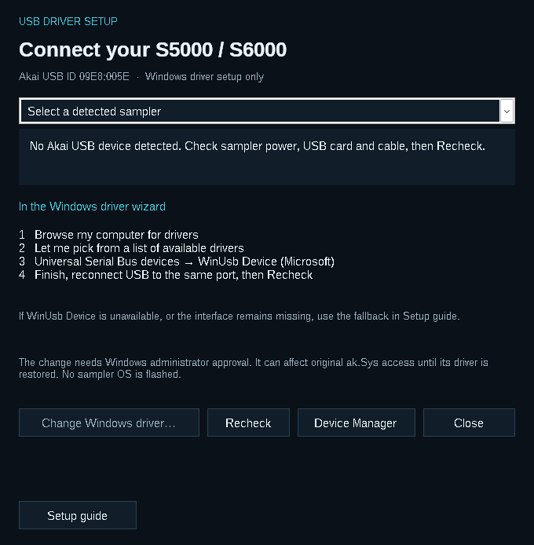

# Connect over USB

[Home](../README.md) · [User guide](USER_GUIDE.md) · [Troubleshooting](TROUBLESHOOTING.md)

The Editor requires an **IB-S56USB card** in the S5000 or S6000 and **Microsoft WinUSB** assigned to that device in Windows. Installing ak.Sys is not required.

## If your sampler already connects

Keep the working driver. Close ak.Sys, the Firmware Updater and any other USB utility before connecting in the Editor. Only one application should use the sampler at a time.

## If Windows chose the wrong driver

Open **Tools → USB driver setup…** while the Editor is disconnected. The assistant can identify the Akai device even when its current driver is missing or unsuitable.

1. Turn on the sampler, connect its USB card to the PC and choose **Recheck**.
2. Select your sampler if more than one is listed. Check the Akai USB identity: **VID 09E8, PID 005E**.
3. Choose **Change Windows driver…**. Windows may ask for administrator approval through UAC.
4. In Windows, choose **Browse my computer for drivers → Let me pick from a list of available drivers**.
5. If offered, select **Universal Serial Bus devices → WinUsb Device (Microsoft)**, then finish the wizard.
6. Reconnect USB to the same PC port if needed. Choose **Recheck**, close the assistant and **Connect** in the Editor.

The assistant targets the selected Akai device. You still choose and confirm the driver in Windows; it does not silently install one. Assign a driver only to the correctly identified sampler.

### The “Have Disk…” option

If your Windows installation includes `winusb.inf`, the assistant displays its actual location. You can select that file using **Have Disk…**, then choose Microsoft's **WinUsb Device**. The file and this option are not available on every Windows installation.

### If WinUSB is not offered

The fallback is [Zadig from its official site](https://zadig.akeo.ie/). Select only the Akai device with USB ID **09E8:005E**, and select **WinUSB** as the driver. This is also a fallback when WinUSB appears assigned but no usable USB interface is registered.

Do not disable driver-signature enforcement. Changing the association can affect original ak.Sys access until its previous driver is restored.

## What the status means

| Status | Next step |
|---|---|
| No Akai device detected | Check sampler power, installed USB card, cable and PC port; choose Recheck. A driver choice cannot fix an absent device. |
| No driver / another driver assigned | Use Change Windows driver and the steps above. |
| WinUSB assigned, no interface registered | Consult the fallback above; a driver name alone does not establish a usable connection. |
| WinUSB and interface present | Close the assistant and Connect. This performs the actual communication check. |

Windows handles the final driver installation. The new assistant's real UAC and driver-binding flow still needs broader hardware testing; the app's software checks do not guarantee every Windows configuration will offer the same choices.

**Driver setup does not flash the sampler's OS.** The firmware updater remains a separate application.

[Microsoft WinUSB guidance](https://learn.microsoft.com/en-us/windows-hardware/drivers/usbcon/winusb-installation) · [Troubleshooting](TROUBLESHOOTING.md)
