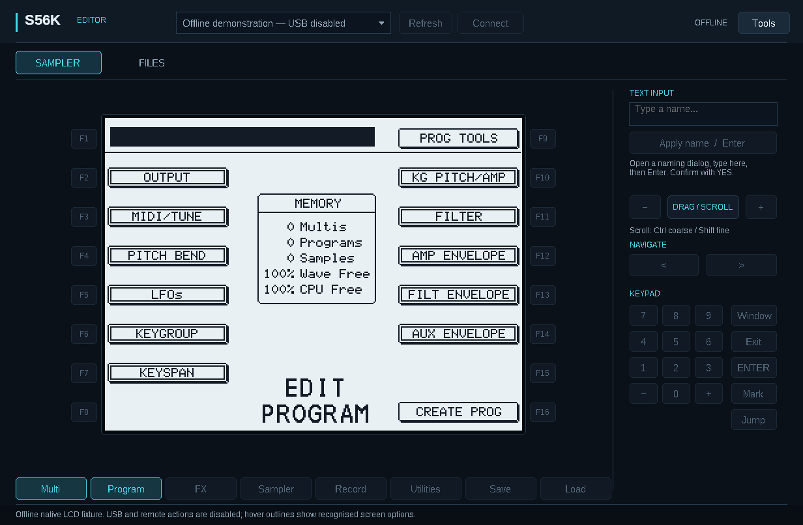
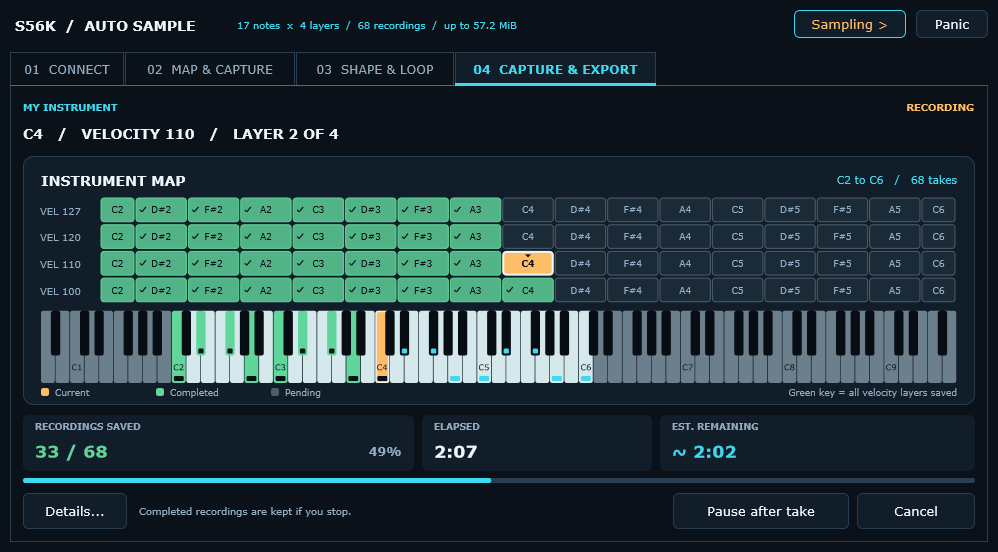
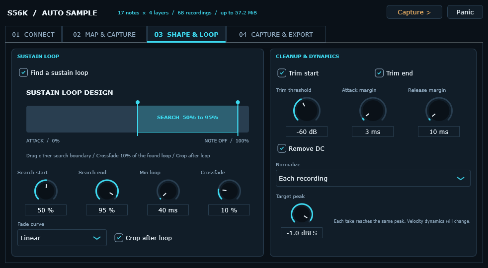
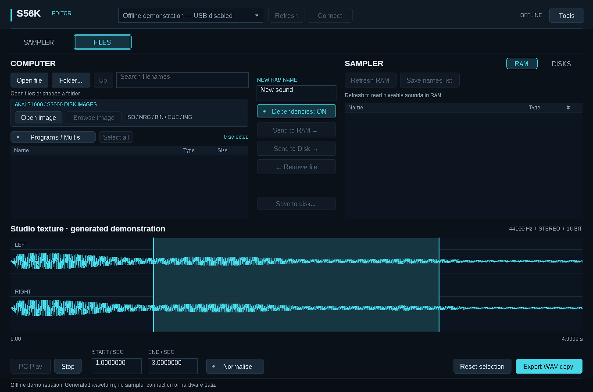
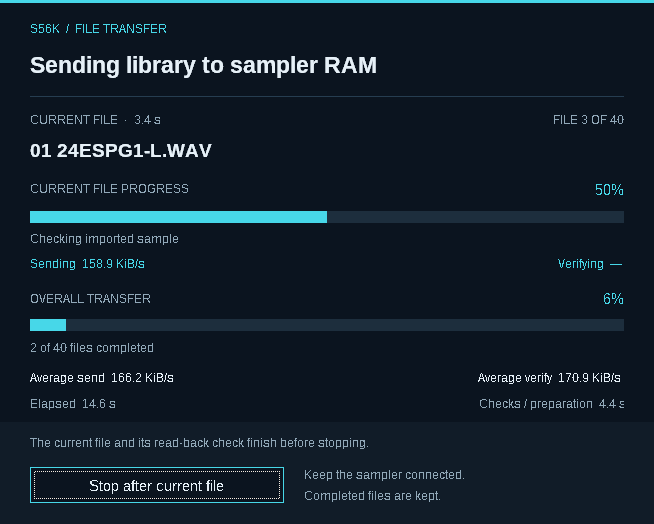
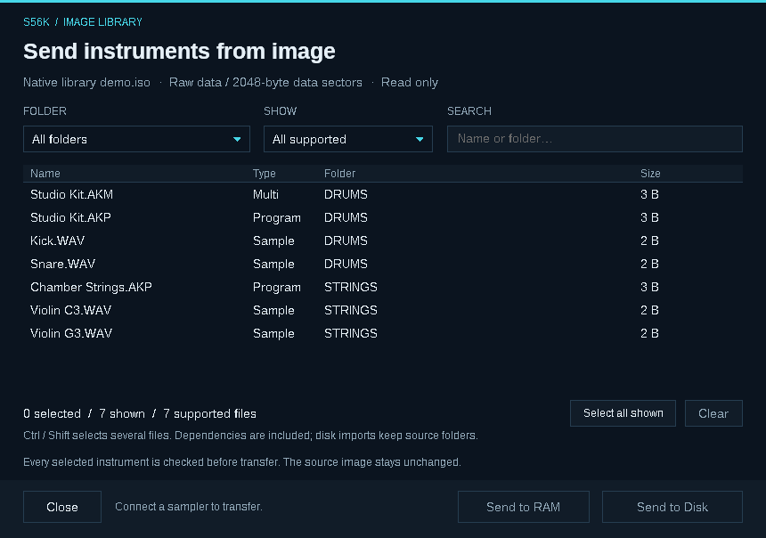

# S56K Editor · User guide

[Home](../README.md) · [Auto Sample & MIDI](AUTO_SAMPLER_GUIDE.md) · [USB setup](USB_SETUP.md) · [Formats](FORMATS.md) · [Troubleshooting](TROUBLESHOOTING.md)

**0.12.8 Auto Sample Preview · Windows 11 · Intel/AMD x64 · AKAI S5000 / S6000**

Bring your sampler's controls, instruments, disk libraries and computer-side Auto Sample into one desktop workspace. Play from a MIDI keyboard, capture hardware or VST3 instruments, and create native AKP/WAV files. Auto Sample and its instrument keyboard route work without a connected sampler.

Remote control and transfers use the sampler's **IB-S56USB expansion card** with Microsoft WinUSB. The Editor works with stock OS 2.14 and S56K Expanded Edition; installing it does not require a firmware update.

[Printable PDF manual](S56K-Editor-0.12.8-User-Guide.pdf)

## Start here

1. Download the Windows ZIP from [Releases](https://github.com/Tubbritt/S56K-Editor/releases/tag/v0.12.8-preview) and **extract all files** into a new folder. Keep the **internal** folder and the other supporting files beside the app.
2. Open **S56K-Editor.exe**. This is the only application you need to launch.
3. To control or transfer to a sampler, turn it on, connect its USB card, select it and choose **Connect**. Close ak.Sys, the Firmware Updater and any other app using that sampler first. If Windows has not assigned a suitable driver, follow **Tools → USB driver setup…** and the [USB setup guide](USB_SETUP.md).
4. To capture a hardware synth or VST3 instrument on the PC, open **AUTO SAMPLE**. The sampler can be connected later when you want to transfer the exported files.

The release is unsigned. Check that your download came from the project release page and matches its supplied checksum. Do not disable Windows security or driver-signature enforcement.

| Area | Use it for |
| --- | --- |
| **SAMPLER** | Control the connected sampler and see its live LCD. |
| **FILES** | Manage computer files, sampler RAM/disks and supported Akai disk images. |
| **AUTO SAMPLE** | Record a hardware synth or hosted VST3, process its sound and export an AKP with WAVs. |
| **MIDI KEYBOARD** | Route a computer-connected keyboard to the Akai or to Auto Sample's selected instrument. |

Local browsing, VST3 playing and Auto Sample do not require an Akai USB connection. USB carries sampler control and file data; it does not turn the sampler into a computer audio interface.

## Your sampler, on screen

Click a recognised option on the LCD, or use the F buttons beside it. The bottom mode buttons follow the current sampler page:

**Multi · Program · FX · Sampler · Record · Utilities · Save · Load**

Changes made on the front panel appear in the Editor too. The LCD updates automatically while the connected Sampler page is visible and idle; transfers and dialogs temporarily pause it. There is no Live switch to turn on.

| Action | How |
|---|---|
| Change a value | Scroll over the LCD or drag/scroll the DATA control. |
| Fine or coarse adjustment | Hold **Shift** for fine changes or **Ctrl** for coarse changes. |
| Enter a name | Open a naming dialog, type in **TEXT INPUT**, then press **Enter** or **Apply name / Enter**. Confirm with **YES** on the sampler screen. |
| Save a screenshot | **Tools → Save LCD image…** saves the latest received LCD as a BMP. |
| Use panel shortcuts | F1–F12; Shift+F1–F8 for F9–F16; digits, arrows, +/−, Enter and Escape. |

Names use up to 20 supported printable characters. Applying a name is enabled only for recognised naming dialogs. Text entry replaces the whole name; you still confirm the result yourself.

The LCD keeps the sampler's native resolution. Clicking the display works for recognised soft-key areas rather than turning every pixel into a new control. The Editor does not expose Undo or user-key buttons in this preview.

## Play from a MIDI keyboard

Open **MIDI KEYBOARD**, select the keyboard's Windows MIDI input and choose a destination:

| Destination | What you need |
| --- | --- |
| **Akai sampler - USB** | Connect the sampler, choose its logical input A or B and the MIDI channel. Hear sound from the sampler's audio outputs. |
| **Auto Sample instrument - external synth / VST3** | In **AUTO SAMPLE → CONNECT**, choose the synth's computer MIDI output or load a VST3 instrument and select an audio output. The sampler need not be connected. |

Click **Connect** once and wait for **Connecting...** to change to the ready status. **Disconnect** stops forwarding. Closing the keyboard window leaves the route active; reopening it remembers the selected device. Use **Panic** to release held notes. If a remembered device is unavailable, choose a connected input explicitly.

Notes, velocity, sustain, pitch bend and supported controllers follow the selected route. Live keyboard playing and Auto Sample's capture/test-note channel are separate settings. For a hardware synth, monitor its outputs directly or through your audio interface; the Editor does not enable input monitoring.

The sampler LCD continues updating while its keyboard route is enabled, and ordinary parameter changes do not automatically send all-notes-off. Dense MIDI traffic can slow screen updates. File transfers release held notes and pause the Akai route until the operation ends. Auto Sample pauses its own keyboard route while capturing, testing a note or reconfiguring the instrument. Play fresh notes when the route is ready again; delayed notes are discarded.

[Full routing and audio setup →](AUTO_SAMPLER_GUIDE.md#play-from-a-midi-keyboard)

## Create an instrument with Auto Sample

Auto Sample is integrated into the Editor. It records selected notes at up to four velocity layers, processes the recordings, and writes a native S5000/S6000 **AKP program plus WAV samples** directly into your chosen export folder.

| Page | Set up |
| --- | --- |
| **01 CONNECT** | Hardware MIDI/audio connections or a 64-bit VST3 instrument, ASIO or Windows audio, and a test note. |
| **02 MAP & CAPTURE** | Low/high note, note step, velocity layers, note/tail/gap times and signal detection. |
| **03 SHAPE & LOOP** | Trimming, DC removal, normalization, sustain-loop search, crossfade and crop-after-loop. |
| **04 CAPTURE & EXPORT** | Program name and export folder, Start Sampling, progress, saved-take review and export. |

For hardware, connect the PC's MIDI output to the synth and its audio outputs to your interface inputs. For VST3, load the instrument and select its sound. **Accelerated rendering** can run supported instruments faster than real time; turn it off when a plugin needs paced processing. No instrument plugins or audio-interface drivers are bundled.

During capture, the current take is amber, completed takes are green and pending takes are subdued. Elapsed time and an adaptive estimate show progress. Loop search uses a percentage window inside the held note. **SHAPE & LOOP** displays a setup diagram; the actual recorded waveform appears for review after the run stops or finishes.

**Start Sampling** always begins a new run. The Editor remembers your settings and identifies a previous export when reopened. **New Patch** clears the name and review while retaining your instrument, device, mapping and processing choices. **Resume project** continues retained incomplete recordings; **Reprocess recordings** applies new processing to retained originals without recording the synth again.

Your export folder receives only the AKP and referenced WAVs. Working recordings and recovery information stay separately under `%LOCALAPPDATA%\S56K\Editor\AutoSampleWork`. Completed working data is cleaned up on normal close only after its export and working files verify. Enable **Details… → Keep working recordings after closing** before closing if you want to reprocess later. Incomplete or failed work is retained for Resume.

Wait for export verification, then choose **Open in Files**, select the AKP with **Dependencies: ON**, and send it to sampler RAM or disk. Existing different export files require replacement approval; **Export files** can retry to another folder without recording again.

[Illustrated Auto Sample guide: setup, loops, exporting and recovery →](AUTO_SAMPLER_GUIDE.md)

## One Files page, two destinations

The **COMPUTER** pane is on the left. Use **Open file** or **Folder…**, search by filename, and double-click a file to inspect it. On the right, choose the sampler's **RAM** or **DISKS**.

| Destination | What happens | What happens next |
|---|---|---|
| **Send to RAM →** | Loads samples, programs and Multis into working memory, ready to play. | Audition the sound, then save it to disk when you want to keep it. |
| **Send to Disk →** | Writes files to the selected sampler disk folder. | Load the saved instrument into RAM when you want to play it. |

Sending to RAM is not a disk backup. Sending to disk does not load the library into RAM. Unsaved RAM contents are lost when the sampler is switched off.

### Send a program, Multi or batch

1. Open the PC folder containing the **AKP programs, AKM Multis and their WAV samples**. Keep their associated files together.
2. Turn on **Programs / Multis** to hide individual samples. Select instruments with Ctrl/Shift-click, **Select all**, or Ctrl+A.
3. Leave **Dependencies: ON** to include the associated files. Choose **Send to RAM →**, or browse a writable sampler disk folder and choose **Send to Disk →**.
4. Read the transfer review, including conversion notices and renamed files. Choose **Start transfer**.
5. Audition the result. If it was sent to RAM, saving remains a separate action.

The filter hides sample rows; it does not remove samples needed by a selected instrument. AKP and AKM files contain settings and references—the audio lives in separate WAV files.

With dependencies on, the Editor prepares the batch before uploading. Shared matching files within that batch are sent once. Different files needing the same destination name receive unique names where the references can be resolved safely. Missing or genuinely ambiguous dependencies stop preparation.

Existing RAM sounds are protected. A source-file conflict with an existing RAM name can stop a transfer. With **Dependencies: OFF**, references may reuse sounds already in RAM by name; their contents are not compared. Use this option only when those sounds are already the correct ones.

### Progress, verification and stopping

The transfer window shows **current-file progress**, **overall progress**, and the current stage. Sending and read-back verification have separate speed measurements; preparation is additional work. Rates are useful data in **KiB/s**, not the USB link's advertised signalling speed.

**Tools → Verify uploads by reading back** is on by default. Turning it off skips the full return transfer and comparison, reducing the time spent verifying. Source validation and sampler acceptance checks remain, but uploaded contents are not independently compared with a returned copy. The choice is remembered; set it before starting a job.

**Stop after current file** completes the active file and its enabled verification before stopping. Completed files remain in their destination. It is not an undo operation, and there is no automatic resume or rollback.

### Retrieve an instrument

Select a sound in sampler RAM, enable **Dependencies: ON**, and choose **← Retrieve file**. Select a new PC folder. The Editor retrieves the instrument and its associated files as separate WAV/AKP/AKM files; it refuses existing destination files.

Keep the sampler idle during retrieval. This is a sequence of reads, not a single instant snapshot. Keep the resulting files together.

## Open your Akai disk-image library

Below the local file controls, **AKAI S1000 / S3000 DISK IMAGES** contains:

- **Open image** — choose a new ISO, NRG, BIN, CUE or IMG library.
- **Browse image** — return to the image already open.

The file picker remembers the last image folder, including after cancellation or an app restart. Computer files and save destinations have separate remembered locations.

1. Choose **Open image**. If a BIN has a CUE sheet, keep both files together and open the **CUE**.
2. Select a volume or folder, filter by type, and search for instruments. Use Ctrl/Shift-click or **Select all shown**. Selection is retained when filters change; **Clear** removes all selections.
3. Choose **Send to RAM** or **Send to Disk**. Image instruments include their dependencies automatically.
4. Read **Image notices** and the transfer review before starting. A readable catalogue can still contain files or dependencies that cannot be imported.

For image-to-disk transfers, first select the destination in the main **DISKS** pane, then return through **Browse image**. The Editor creates an `Import YYYYMMDD-HHMMSS` folder with subfolders for source volumes. This route does not require the entire library to fit in sample RAM.

The source image is read-only. Conversion happens on the PC as files are prepared; current transfers do not extract a prepared library into AppData. Keep the source files unchanged during the job. See [supported formats and limits](FORMATS.md) for container and conversion details.

## Work with the sampler's disks

Choose **DISKS**, select a volume and open a folder. **Up**, **Root** and **Refresh** navigate or reread that location. This browser is independent of the sampler's current front-panel disk selection.

| Action | Use it for |
|---|---|
| **Create folder** | Create the name entered in **NEW FOLDER NAME** on a writable disk. |
| **Send to Disk →** | Copy selected PC files or an instrument batch into the chosen destination. |
| **← Retrieve file** | Copy one selected sampler-disk file to a new PC filename. |
| **Load to RAM** | Ask the sampler to load the selected WAV, AKP or AKM, with dependencies when enabled. |
| **Save to disk… / Save RAM here** | Select a RAM object, choose Save to disk, navigate to the destination and confirm Save RAM here. |

Saving an instrument with dependencies needs an **empty folder**. Create a new folder first. Existing destination files are not silently overwritten. Read-only media can be browsed and retrieved.

A stopped or failed disk operation can leave completed files, partial files or new folders. Inspect the destination before retrying. Free-space estimates cannot account for every allocation or media condition.

## Waveform inspection on the PC

Open a WAV to inspect its waveform and duration. **PC Play** uses the computer's audio output. Set the selection start/end and optional **Normalise**, then choose **Export WAV copy** to create an edited PCM16 copy.

When editing a supported native Akai WAV, full-range export and normalization preserve its tuning, playback mode, sample bounds and supported loop settings. Trimming moves retained sample bounds and loops to match the new audio. If a trim cuts through a loop, the Editor removes that loop and switches off looped playback; review the warning before saving. A retained loop needs the sampler's required audio after its end. Unsupported native metadata or a trim leaving no playable region is refused.

The original WAV stays unchanged. Preview plays the source audio; it does not apply pending edits or emulate the sampler's tuning, sample bounds and playback modes. Check the edited copy on the sampler before replacing library files.

**Send to RAM sends the whole selected WAV.** To upload your waveform edit, select the exported copy. USB does not turn the sampler into an audio interface.

## Tools, explained

| Command | Purpose |
|---|---|
| **USB driver setup…** | Inspect the Akai device's Windows driver while disconnected, with an option to open its Windows driver wizard. |
| **Save troubleshooting log…** | Save this session's connection, error and transfer details to a local text file. It can include filenames and paths, but no sample audio. Review it before sharing. Nothing is uploaded automatically. |
| **Save LCD image…** | Save the most recently received sampler screen as a BMP. |
| **Verify uploads by reading back** | Enable or disable full returned-content comparisons for uploads. |
| **Review legacy import folders…** | Appears only if early Editor versions left an import folder. Opens it in Explorer so you can review it yourself. Nothing is deleted automatically. |
| **Getting started** | Open the bundled offline guide. |

The separate [Firmware Updater and Expanded Edition firmware](https://github.com/Tubbritt/S56K-Expanded-Edition/releases) are not included or launched by the Editor. Close the Editor before using another USB application.

## Before a large library transfer

Try a small instrument first and listen to its pitch, stereo image, release and loops. Keep a backup of your work, read any conversion notices, and check available RAM or disk space. This preview does not promise compatibility with every library or hardware configuration.

[Supported formats](FORMATS.md) · [Troubleshooting](TROUBLESHOOTING.md) · [Licence](../LICENSE.md) · [Disclaimer](../DISCLAIMER.md)
